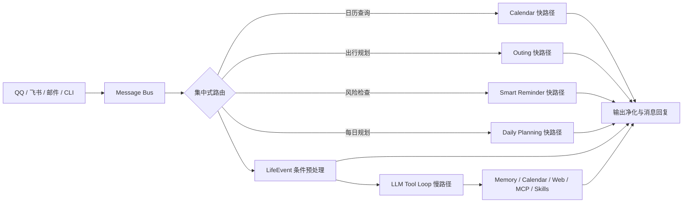

<div align="center">
  
  <h1>Copala</h1>
  <p>能记忆、会判断、可主动执行并沉淀技能的个人智能 Agent</p>

  [English](README_EN.md) · [快速开始](docs/getting-started.md) · [架构](docs/architecture.md) · [评测](docs/evaluation.md)

  [](https://github.com/yuyue1413/Copala/actions/workflows/ci.yml)
  [](https://www.python.org/)
  [](https://docs.astral.sh/ruff/)
  [](LICENSE)
</div>

> [!WARNING]
> Copala 目前处于 **Alpha** 阶段，适合学习、实验和作品展示，尚未达到生产就绪标准。涉及日历写入、邮件读取、Shell 或外部服务时，请先阅读[安全说明](SECURITY.md)。

Copala 基于开源项目 [nanobot](https://github.com/HKUDS/nanobot) 二次开发。它保留了 nanobot 的多通道接入、Provider 抽象、LLM Tool Loop、Cron/Heartbeat 与 Skills 基座，并重点新增混合长期记忆、确定性领域路由、LifeEvent 主动闭环、多源情境规划及运行时技能沉淀。

## 为什么是 Copala

| 能力 | nanobot 基座 | Copala 新增机制 |
| --- | --- | --- |
| 对话与工具 | Channel、Provider、Tool Loop | 领域快路径与慢路径分层决策，显式路由优先级 |
| 记忆 | 会话历史与摘要 | SQLite FTS5/BM25 + 192 维本地 signed-hash Dense + RRF |
| 主动性 | Cron、Heartbeat | LifeEvent 检测、日历/TODO/提醒/通知闭环及幂等抑制 |
| 规划 | 通用工具调用 | 记忆、日历、高德、天气与 Web Search 多源编排及故障降级 |
| 技能 | 静态 Skills | LearnSkillTool 保存、发现、复用与安全隔离 |

## Agent 架构



快路径按 `Calendar → Outing → SmartReminder → DailyPlanning` 顺序执行；未命中后由 LifeEvent 做非终止型事件预处理，最后进入 LLM Tool Loop。这样既保留长尾推理能力，也让高频领域请求可以确定性执行，并避免不必要的模型调用。详见[架构说明](docs/architecture.md)。

## 快速开始

要求 Python 3.11–3.13。建议在虚拟环境中安装：

```bash
python -m venv .venv
# Linux / macOS
source .venv/bin/activate
# Windows PowerShell
# .\.venv\Scripts\Activate.ps1

python -m pip install -e .
copala onboard
```

编辑 `~/.copala/config.json`；Windows 对应 `%USERPROFILE%\.copala\config.json`。最小配置示例：

```json
{
  "providers": {
    "openrouter": {"apiKey": "YOUR_API_KEY"}
  },
  "agents": {
    "defaults": {
      "model": "openrouter/openai/gpt-4o-mini",
      "provider": "openrouter"
    }
  }
}
```

首次对话与启动消息通道：

```bash
copala agent -m "根据我的偏好安排今天"
copala gateway
```

`gateway` 是消息通道、Agent、Cron 与 Heartbeat 的运行入口，不是面向浏览器的普通 HTTP 服务。完整步骤见[快速开始](docs/getting-started.md)，所有字段见[配置参考](docs/configuration.md)。

## 核心机制

### 长期记忆

对话、邮件、日历和规划产物会被抽取为结构化记忆，存入 SQLite。检索时并行运行 FTS5/BM25 与 192 维本地 signed-hash Dense 召回，再用 RRF 融合并注入当前上下文。该 Dense 表示是确定性的本地特征散列，**不是神经网络 Embedding**，无需外部向量服务。

```bash
copala memory reindex
copala memory search "旅行偏好" --limit 5
copala memory list --type travel_preference
```

### 主动事件闭环

LifeEvent 从聊天、邮件和日历巡检中识别会议、面试、体检、航班、酒店与账单等事件，并根据置信度、事件类型和时间完整性连接日历、TODO、Cron、RAG 与通知。来源标识用于同源重放去重。普通 Agent 日历写入默认生成草案；`lifeEvents.calendarWriteMode` 当前仍是预留配置，尚未约束 LifeEvent 的直接日历写入链路，因此真实账户启用前应先使用测试日历并评估副作用风险。

```bash
copala life-events list
copala life-events reprocess-email --limit 20
copala calendar status
```

### 多源规划与风险降级

每日与出行规划会组合固定日程、长期偏好、生活事件、路线/天气、预算和 Web 信息。外部服务失败时保留已获得的上下文，按降级契约输出可执行计划，而不是让整个链路失败。

```bash
copala smart-reminders check --days 2
copala smart-reminders patrol
```

### 技能沉淀

`LearnSkillTool` 可将一次任务中的可复用解法保存为脚本、`SKILL.md` 与 manifest，使 Agent 在后续会话中重新发现和复用；同时提供路径隔离、敏感信息提示和覆盖保护。

## 常用命令

```text
copala onboard                         初始化配置与工作区
copala agent [-m MESSAGE]              单轮或交互式对话
copala gateway                         启动通道与后台任务
copala status                          查看配置和 Provider 状态
copala memory --help                   管理长期记忆
copala calendar --help                 管理本地/飞书日历
copala life-events --help              管理生活事件
copala smart-reminders --help          检查情境风险
copala channels status                 查看消息通道
copala provider login PROVIDER         执行 OAuth 登录
```

## 离线评测

冻结数据集哈希：`c7bfab38d7d07c20d6537298e6da5e2dc2988eb5c9841a9e770a17e1fc672178`。以下结果来自 Commit `f4ecb42` 时点的离线标注集与可控故障注入，不代表生产准确率，也不包含在线模型 Token 或真实飞书/高德网络延迟。

| 维度 | 留出集/场景 | 结果 |
| --- | ---: | --- |
| 长期记忆 | 30 条留出查询 | Recall@5 90.0%，MRR@5 0.711，nDCG@5 0.760 |
| Agent 路由 | 60 条留出指令 | Accuracy / Macro-F1 均为 100%，通用请求误拦截率 0% |
| 快路径 | 40 条命中请求 | 40/40 零模型调用 |
| LifeEvent | 48 条留出样本 | 检测 F1 98.6%，20/20 重复输入被抑制 |
| 规划降级 | 40 个故障注入场景 | 40/40 生成成功，必要章节覆盖率 100% |
| 技能沉淀 | 30 个功能/安全场景 | 30/30 通过 |

10,000 条本地记忆规模下，检索 P50/P95 三轮中位数为 649.66/691.75 ms。复现方法、原始 JSON 和完整口径见[评测文档](docs/evaluation.md)。

## 项目结构

```text
src/copala/        可发布源码
tests/             单元与兼容性测试
evaluation/        冻结数据、离线评测入口和原始结果
examples/          脱敏配置与使用示例
scripts/           仓库维护脚本
docs/              架构、配置、集成、评测与排障
.github/           CI、Issue、PR 和依赖管理
```

## 文档

- [快速开始](docs/getting-started.md)
- [配置参考](docs/configuration.md)
- [外部集成](docs/integrations.md)
- [Agent 架构](docs/architecture.md)
- [评测复现](docs/evaluation.md)
- [排障指南](docs/troubleshooting.md)
- [开发指南](docs/development.md)
- [支持策略](SUPPORT.md)

## 安全与限制

- 示例只使用占位凭证；不要提交 `config.json`、`.env`、OAuth Token、邮箱授权码或真实用户数据。
- 建议保持 `calendar.writeMode="draft"` 并启用 `tools.restrictToWorkspace`；自动 LifeEvent 写入需单独评估。
- 本地 signed-hash Dense 适合离线、低依赖场景，不等价于语义神经向量模型。
- 当前评测是离线确定性测试；通道、模型和第三方 API 的真实质量取决于网络、权限与供应商状态。
- 安全问题请按[安全策略](SECURITY.md)私下报告，不要在公开 Issue 中披露密钥或漏洞细节。

## 参与贡献

提交改动前请阅读[贡献指南](CONTRIBUTING.md)与[行为准则](CODE_OF_CONDUCT.md)。路线建议、缺陷和功能请求可使用仓库 Issue 表单。

## 许可与致谢

本项目采用 [MIT License](LICENSE)。Copala 基于 nanobot 的 MIT 许可代码进行二次开发；上游版权与变更说明见 [NOTICE.md](NOTICE.md) 和 [LICENSE.nanobot](LICENSE.nanobot)。感谢 [HKUDS/nanobot](https://github.com/HKUDS/nanobot) 及其贡献者提供轻量 Agent 基座。
