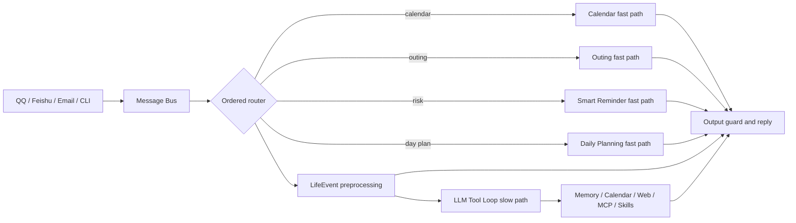

<div align="center">
  
  <h1>Copala</h1>
  <p>A personal AI agent that remembers, decides, acts proactively, and grows reusable skills</p>

  [中文](README.md) · [Quick start](docs/getting-started.md) · [Architecture](docs/architecture.md) · [Evaluation](docs/evaluation.md)

  [](https://github.com/yuyue1413/Copala/actions/workflows/ci.yml)
  [](https://www.python.org/)
  [](https://docs.astral.sh/ruff/)
  [](LICENSE)
</div>

> [!WARNING]
> Copala is **Alpha** software for learning, experimentation, and portfolio demonstrations. It is not production-ready. Review [SECURITY.md](SECURITY.md) before enabling calendar writes, mailbox access, shell execution, or external services.

Copala is a derivative of [nanobot](https://github.com/HKUDS/nanobot). It retains nanobot's channels, provider abstraction, LLM tool loop, Cron/Heartbeat, and Skills foundation, while adding hybrid long-term memory, deterministic domain routing, a proactive LifeEvent pipeline, resilient multi-source planning, and runtime skill persistence.

## What Copala adds

| Area | nanobot foundation | Copala extension |
| --- | --- | --- |
| Agent execution | Channels, providers, tool loop | Ordered domain fast paths plus an LLM slow path |
| Memory | Session history and summaries | SQLite FTS5/BM25 + 192-dimensional local signed-hash Dense retrieval + RRF |
| Proactivity | Cron and Heartbeat | LifeEvent detection and idempotent calendar/TODO/reminder/notification actions |
| Planning | General tool use | Memory, calendar, Amap, weather, and Web Search orchestration with graceful degradation |
| Skills | Static skills | LearnSkillTool persistence, rediscovery, reuse, and safety isolation |

## Agent architecture



Fast paths run in the explicit order `Calendar → Outing → SmartReminder → DailyPlanning`. Non-terminal LifeEvent preprocessing and the general LLM tool loop handle the remaining requests. See [Agent architecture](docs/architecture.md).

## Quick start

Python 3.11–3.13 is supported:

```bash
python -m venv .venv
# Linux / macOS
source .venv/bin/activate
# Windows PowerShell: .\.venv\Scripts\Activate.ps1
python -m pip install -e .
copala onboard
```

Edit `~/.copala/config.json` (`%USERPROFILE%\.copala\config.json` on Windows):

```json
{
  "providers": {"openrouter": {"apiKey": "YOUR_API_KEY"}},
  "agents": {
    "defaults": {
      "model": "openrouter/openai/gpt-4o-mini",
      "provider": "openrouter"
    }
  }
}
```

```bash
copala agent -m "Plan my day using my preferences"
copala gateway
```

`gateway` runs channels, the Agent, Cron, and Heartbeat; it is not a conventional browser-facing HTTP server. See the [quick-start guide](docs/getting-started.md) and [configuration reference](docs/configuration.md).

## Core mechanisms

### Long-term memory

Copala extracts structured memory from conversations, mail, calendars, and planning artifacts. It combines SQLite FTS5/BM25 and a 192-dimensional local signed-hash Dense representation with RRF before injecting retrieved context. The Dense representation is deterministic feature hashing, **not a neural embedding**, and requires no external vector service.

```bash
copala memory reindex
copala memory search "travel preferences" --limit 5
copala memory list --type travel_preference
```

### Proactive LifeEvent loop

LifeEvent detects meetings, interviews, medical appointments, flights, hotels, and bills from chat, mail, and calendar patrols. Confidence, event type, and time completeness control calendar, TODO, Cron, memory, and notification actions. Source identifiers suppress same-source replays. General calendar writes default to drafts; `lifeEvents.calendarWriteMode` is currently reserved and does not yet govern LifeEvent's direct calendar-write path, so use a test calendar and assess side-effect risks before enabling it on a real account.

### Resilient multi-source planning

Daily and outing planning combine fixed events, long-term preferences, LifeEvents, routes/weather, budgets, and Web data. A degradation contract preserves available context when an external service fails.

### Skill persistence

`LearnSkillTool` stores reusable solutions as scripts, `SKILL.md`, and a manifest for later rediscovery. Path isolation, secret warnings, and overwrite protection constrain this growth mechanism.

## Common commands

```text
copala onboard                         Initialize config and workspace
copala agent [-m MESSAGE]              Start one-shot or interactive chat
copala gateway                         Start channels and background jobs
copala status                          Inspect config and provider status
copala memory --help                   Manage long-term memory
copala calendar --help                 Manage local and Feishu calendars
copala life-events --help              Manage LifeEvents
copala smart-reminders --help          Inspect contextual risks
copala channels status                 Inspect channels
copala provider login PROVIDER         Run an OAuth login flow
```

## Offline evaluation

Frozen dataset hash: `c7bfab38d7d07c20d6537298e6da5e2dc2988eb5c9841a9e770a17e1fc672178`. Results below were measured at Commit `f4ecb42` using offline labels and controlled fault injection. They are not production metrics and exclude online-model tokens and real Feishu/Amap network latency.

| Area | Holdout/scenarios | Result |
| --- | ---: | --- |
| Memory | 30 holdout queries | Recall@5 90.0%, MRR@5 0.711, nDCG@5 0.760 |
| Routing | 60 holdout instructions | 100% Accuracy/Macro-F1, 0% generic-request false interception |
| Fast paths | 40 matched requests | 40/40 with zero model calls |
| LifeEvent | 48 holdout samples | Detection F1 98.6%, 20/20 duplicates suppressed |
| Planning | 40 fault scenarios | 40/40 plans generated, 100% required-section coverage |
| Skill persistence | 30 functional/safety scenarios | 30/30 passed |

At 10,000 local memories, median P50/P95 across three runs was 649.66/691.75 ms. See [evaluation reproduction](docs/evaluation.md) for raw results and scope.

## Repository layout

```text
src/copala/        Publishable source
tests/             Unit and compatibility tests
evaluation/        Frozen data, runner, and raw results
examples/          Sanitized config and usage examples
scripts/           Repository maintenance scripts
docs/              Architecture, config, integrations, evals, troubleshooting
.github/           CI and collaboration configuration
```

## Documentation

- [Quick start](docs/getting-started.md)
- [Configuration](docs/configuration.md)
- [Integrations](docs/integrations.md)
- [Agent architecture](docs/architecture.md)
- [Evaluation](docs/evaluation.md)
- [Troubleshooting](docs/troubleshooting.md)
- [Development](docs/development.md)
- [Support](SUPPORT.md)

## Security and limitations

- Never commit config files, `.env`, OAuth tokens, mailbox passwords, or personal data.
- Keep `calendar.writeMode="draft"` and consider `tools.restrictToWorkspace=true`; review LifeEvent writes separately.
- Local signed-hash Dense retrieval is not equivalent to a neural semantic embedding model.
- Offline deterministic tests do not measure real channel, model, or third-party API behavior.
- Report vulnerabilities privately according to [SECURITY.md](SECURITY.md).

## Contributing, license, and credits

Read [CONTRIBUTING.md](CONTRIBUTING.md) and [CODE_OF_CONDUCT.md](CODE_OF_CONDUCT.md) before contributing. Copala is released under the [MIT License](LICENSE). The upstream nanobot license and derivative-work notice are preserved in [LICENSE.nanobot](LICENSE.nanobot) and [NOTICE.md](NOTICE.md). Thanks to [HKUDS/nanobot](https://github.com/HKUDS/nanobot) and its contributors.
