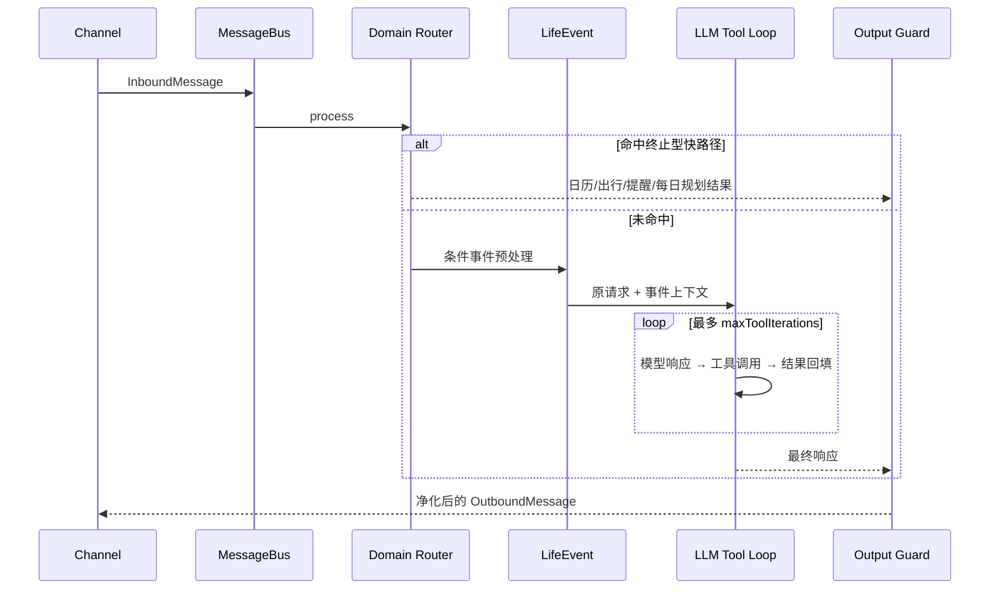
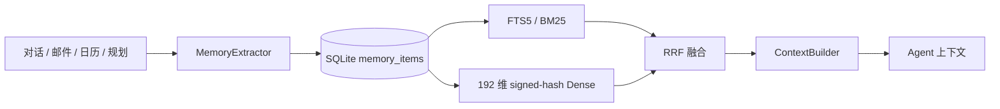

# Agent 架构

## 处理链

`src/copala/agent/routing.py` 集中声明路由名称、处理器和优先级。`AgentLoop` 保留原有 `_looks_like_*` 静态方法作为兼容包装。输出错误识别、敏感后端信息净化和未验证日历写入声明校验位于 `output_guard.py`。

## 决策优先级

1. Calendar：只读日历查询与认证状态。
2. Outing：旅行、商场或临时外出的结构化规划。
3. SmartReminder：天气、路线、冲突和截止风险检查。
4. DailyPlanning：固定日程与可移动任务的日内规划/重排。
5. LifeEvent：非终止型事件检测和主动副作用编排。
6. LLM slow path：处理通用对话和长尾工具任务。

快路径返回 `None` 表示条件不满足或当前 Channel 未启用该领域服务，路由继续向后；返回文本则终止本轮路由。

## 长期记忆

本地 Dense 通过特征散列提供无服务依赖的相似性信号，并非神经语义 Embedding。每条结果保留类型、来源、置信度和 metadata，便于审计上下文来源。

## LifeEvent 主动闭环

LifeEvent 将检测、字段抽取、策略判断与副作用拆开：事件类型和字段决定是否满足执行条件；日历、TODO、Cron、RAG 与通知分别由领域服务完成；`source_ref` 和持久化状态用于去重。后台邮件/日历巡检使用配置的默认通知通道，聊天触发则优先返回当前通道。

## 多源规划

每日规划和出行规划读取可用的记忆、日历、事件、路线、天气、预算与 Web 信息。各数据源有独立错误边界；单源失败只标记对应信息不可用，计划仍以其余上下文生成。确定性章节契约保证降级结果仍说明日程、路线、天气、预算或记忆依据的状态。

## 技能成长

`LearnSkillTool` 把运行时解法写入工作区的 `learned/scripts/`、`skills/learned-*/SKILL.md` 和 manifest。能力增长必须通过路径隔离、敏感信息提示和覆盖保护；它是可追溯的本地制品机制，不代表 Agent 可自行扩大权限。
